<div align="center">

# VulnIntel

[한국어](README.md) · **English** · [简体中文](README.zh-CN.md)

**Vulnerability data from 9 public sources, including NVD, OSV, GitHub Advisory, CISA KEV, EPSS, Exploit-DB, and KISA, through a single web app and API.**

[](https://www.vulnintelapp.com/)
[](https://www.vulnintelapp.com/en/developers)

[](https://nextjs.org)
[](https://fastapi.tiangolo.com)
[](https://python.org)
[](https://postgresql.org)

</div>

---

## What it solves

Vulnerability information is scattered across many places. To get the full picture on a single CVE, you check CVSS on NVD, find affected packages and fixed versions on OSV or GitHub Advisory, check CISA KEV for whether it's actually being exploited, and look up EPSS for how likely exploitation is, all separately. Korean advisories live in yet another place, KISA's Boho.or.kr, and since most of this material is in English, sharing it with your team means writing it up again.

| Problem | Reality |
|---------|---------|
| **The data is scattered** | Each source has its own format and identifiers (CVE, GHSA, OSV ID), so even matching up records for the same vulnerability is manual work. |
| **CVSS alone doesn't set the order** | A CVSS 9.8 with no exploitation signals, or a CVSS 7.0 that's already being used in attacks. Which do you fix first? |
| **Building it yourself means maintaining it** | You have to keep up with per-source rate limits, large dumps, schema changes, and deduplication. |

VulnIntel collects these sources daily, merges them into a single vulnerability record, and attaches a priority (VPI) that weighs CVSS together with exploitation signals, ready to use from the web, the API, and CI.

```mermaid
flowchart LR
    subgraph SRC["Public data sources (9)"]
        direction TB
        NVD["NVD"]
        OSV["OSV"]
        GHSA["GitHub Advisory"]
        KEV["CISA KEV"]
        EPSS["FIRST EPSS"]
        EDB["Exploit-DB"]
        NUC["nuclei-templates"]
        PIG["PoC-in-GitHub"]
        KISA["KISA (Boho.or.kr)"]
    end

    SRC --> COL["Collection (scheduled)"]
    COL --> NORM["Normalization · alias merging · deduplication"]
    NORM --> VPI["VPI score · level calculation"]
    NORM --> TR["Korean · Chinese machine translation"]
    VPI --> DB[("PostgreSQL")]
    TR --> DB
    DB --> API["REST API"]
    API --> WEB["Web"]
    API --> CI["CI · scripts"]
    DB --> OUT["Remediation reports · alerts<br/>Email · Slack · Telegram"]
```



---

## Data sources and update schedule

| Source | What we pull | Updated (KST) |
|--------|--------------|---------------|
| NVD | CVE descriptions, CVSS v2/v3.x/v4.0, affected products (CPE), CWE, NVD processing status | Daily 09:00 · 21:00 |
| OSV | Affected version ranges and fixed versions for packages in 8 ecosystems | Daily 01:00 · 13:00 |
| GitHub Advisory | GHSA advisories, affected package ranges | Daily 04:30 |
| CISA KEV | Known-exploited listings, date added and due date, known ransomware use, required action | Daily 14:00 |
| FIRST EPSS | Probability of exploitation within 30 days, and percentile | Daily 15:00 |
| Exploit-DB | Whether a public exploit (PoC) exists | Daily 02:30 |
| nuclei-templates | Whether a remote detection template exists | Daily 05:00 |
| PoC-in-GitHub | Links to and count of public PoC repositories (auto-collected, unverified) | Daily 05:10 |
| KISA (Boho.or.kr) | Security bulletin ID, title, date, and source link; affected-product tables; bulletin ↔ CVE mapping | Daily 09:30 · 21:30 |

Jobs that run after collection are also on a fixed schedule.

| Job | Time (KST) |
|-----|------------|
| VPI recalculation (EPSS updates are applied at collection time) | Daily 06:00 |
| Remediation report publishing / report email | Daily 06:30 / 07:00 |
| Subscription alert digest | Daily 09:00 |
| Translation (Korean · Chinese) | Every 3 hours |

In addition, when you choose a **Precise** scan, VulnIntel looks up component licenses, deprecation status, and OpenSSF Scorecard scores on deps.dev (Google Open Source Insights) and adds them to the results.

### Data volume

As of 2026-10-16, from the production database.

| Item | Count |
|------|------:|
| Unified vulnerabilities (deduplicated) | 1,037,741 |
| Per-source aliases (GHSA, OSV IDs, etc.) | 822,649 |
| Reference links | 1,548,598 |
| NVD CPE products | 371,489 |
| CVE ↔ affected-product relationships | 2,335,679 |
| CWE mappings | 399,378 |
| Affected package ranges | 88,615 |
| CISA KEV entries | 1,745 |
| KISA security bulletins | 2,562 |
| Korean translations completed | 128,167 |

---

## Key features

### 1. Unified vulnerability lookup

Search by CVE ID, GHSA ID, or OSV ID and you get the same record. A single detail record includes:

- CVSS scores and vectors from each source, plus one primary score and its source type (NIST / CNA / third party)
- Affected packages (ecosystem, version range, fixed version) and affected products from NVD CPE
- CISA KEV date added, due date, and known ransomware use, plus the required action classified by type
- EPSS probability and percentile, public exploit availability, nuclei detection templates, PoC-in-GitHub repository count
- KISA security bulletin mapping (ID, title, date, source link)
- CWE, NVD processing status, and the list of sources that contributed to the record
- VPI score and level, with the basis for the calculation

The list API can filter by severity, KEV listing, KISA bulletin reference, public exploit, detection template availability, ransomware, ecosystem, CVSS/VPI/EPSS ranges, VPI level, publication date, and vendor/product, and sort by VPI, CVSS, EPSS, KEV date added, and more.

### 2. VPI: what to fix first

VPI (Vulnerability Priority Index) is a 0–100 score that weighs CVSS (impact) together with exploitation signals. The web UI shows only the **VPI level (L1–L6)**, which groups scores by the action they call for; the score itself is used in the API and for sorting. Vulnerability list and detail responses include the calculation breakdown (`vpi_breakdown`).

**Score (formula version `vpi-v2`)**

```
VPI = min( base(tier) + width(tier) × CVSS / 10 + ransomware bonus, 100 )
```

Exploitation signals are not added together. Only the first matching tier from the top applies. KEV, PoC, and EPSS all measure the same thing, the likelihood of exploitation, so adding them would count the same signal more than once.

| Tier | Condition | Base | Width | Score range |
|------|-----------|-----:|------:|-------------|
| `kev` | Listed in CISA KEV | 60 | 40 | 60–100 |
| `poc` | Public exploit confirmed (listed in Exploit-DB, or a reference tagged Exploit) | 30 | 50 | 30–80 |
| `epss_high` | EPSS percentile in the top 10% | 25 | 45 | 25–70 |
| `baseline` | None of these signals | 0 | 65 | 0–65 |

- Ransomware bonus: +5 when CISA KEV confirms known ransomware use
- With no CVSS score, the midpoint of the severity rating is used (CRITICAL 9.5 · HIGH 8.0 · MEDIUM 5.5 · LOW 2.0); with no rating either, 5.5 is used. A missing EPSS score does not lower the score.
- The tier values and the EPSS threshold are estimates made before backtesting. If they change, `formula_version` is bumped to tell the versions apart.

**Levels**

| Level | Name | Condition | Recommended action |
|-------|------|-----------|--------------------|
| L6 | Top priority | Listed in KEV + (known ransomware use or CVSS 9.0+) | Act on affected assets first and check for signs of compromise |
| L5 | Urgent | Listed in KEV | Confirm affected assets, then apply patches or mitigations first |
| L4 | Priority | CVSS 9.0+ + attack signal | Handle in this patch cycle |
| L3 | Planned | CVSS 9.0+ / CVSS 4.0–8.9 + attack signal / attack signal only, without impact data | Include in the regular patch schedule |
| L2 | Monitor | CVSS 4.0–8.9 / CVSS below 4.0 + attack signal | Track |
| L1 | Routine | CVSS below 4.0 | Handle in the regular cycle |
| — | Not rated | Neither impact data nor attack signals, or NVD Rejected | Re-assess once impact data is available |

An attack signal is a public PoC or an EPSS score in the top 10%. Even when both apply, the level goes up by only one step. Vulnerabilities not in KEV are capped at L4.

| Case | CVSS | Exploitation signal | VPI | Level |
|------|-----:|---------------------|----:|-------|
| Example A | 9.8 | None | 63.70 | L3 Planned |
| Example B | 7.5 | Public PoC | 67.50 | L3 Planned |
| Example C | 7.0 | CISA KEV | 88.00 | L5 Urgent |
| Log4Shell (CVE-2021-44228) | 10.0 | CISA KEV + ransomware | 100.00 | L6 Top priority |

A CVSS 7.0 vulnerability that is actually being exploited ranks above a 9.8 with no signals.

### 3. Dependency and SBOM scanning with CI gates

Upload a lock file or SBOM and it is processed as an asynchronous job that returns per-package verdicts, policy results, and an SBOM.

- **Input**: CycloneDX JSON, SPDX 2.x JSON, `package-lock.json`, `composer.lock`, NuGet `packages.lock.json`, `Cargo.lock`, `Gemfile.lock`, `go.sum`, `mvn dependency:tree` output, `requirements.txt`. The format is detected from the content, not the file name.
- **Ecosystems assessed**: npm · PyPI · Go · crates.io · Maven · RubyGems · NuGet · Packagist
- **Five verdict states**: `affected` (Affected) · `fixed` (Fixed) · `not_affected` (Not affected) · `unknown` (Needs review) · `unsupported` (Not supported). A result that could not be confirmed as not affected is never labeled "safe."
- **Policy gate**: Pass rules as JSON and get back `policy.passed` and the list of violations.

  | Rule | Triggers when |
  |------|---------------|
  | `kev_present` | Any vulnerability is listed in CISA KEV |
  | `cvss_threshold` | More than `max_count` vulnerabilities have CVSS ≥ `min_score` |
  | `severity_threshold` | More than `max_count` vulnerabilities have the specified severity |
  | `ignore_list` | Exempts the specified CVEs and GHSAs |

  Each rule acts as either `fail` or `warn`. If you omit the policy, the defaults apply: fail on any KEV listing, fail on one or more vulnerabilities with CVSS 9.0+, and warn on more than 5 with CVSS 7.0+.
- **VEX**: Upload an OpenVEX or CycloneDX VEX document alongside, and items declared `not_affected` or `fixed` are excluded from the gate. Each exclusion is recorded in `policy.suppressed` with its justification, author, and timestamp.
- **SBOM output**: Download the results as a CycloneDX 1.7 SBOM.
- **SBOM completeness check**: Shows whether an uploaded SBOM meets the CISA 2026 minimum elements, and what is missing.
- **Precise scan**: Adds component license classification (permissive / weak, strong, or network copyleft / other / unknown), deprecated packages, and OpenSSF Scorecard scores.

### 4. Remediation reports and remediation ledger

Every morning, VulnIntel publishes a report on CVEs newly added to CISA KEV and previously known CVEs for which a public exploit has since appeared. On days with no such CVEs, no report is published.

- For each CVE, the report compiles a Korean summary, affected range and patched versions, commands to check the installed version, KISA bulletin links, the CISA required action, and PoC sources.
- Download a report as an XLSX remediation log, or get it by email (07:00 KST).
- Record a remediation status (Open · In progress · Done · Won't fix · Not applicable) and a reason for each item. Open items come back to you as reminder emails.

### 5. Alerts

Subscribe to what you care about, and new vulnerabilities matching your conditions are bundled and sent daily at 09:00 KST.

- Subscription targets: packages (ecosystem + name), CVEs, vendors, new CISA KEV listings
- Channels: Email · Slack (Incoming Webhook) · Telegram (Bot)
- Delivery history is available on the settings page.

### 6. Korean language and Korea-specific data

- The UI is available in Korean, English, and Chinese (Simplified).
- CVE titles and descriptions are machine-translated into Korean and Chinese, starting with the highest-VPI vulnerabilities. Where no translation exists yet, the original English text is shown.
- KISA security bulletins are linked to CVEs and shown on detail pages and the dashboard. Bulletin bodies are copyright-reserved, so only factual information is used, such as the ID, title, date, source link, and affected-product table.

---

## How to try it

### Web: [www.vulnintelapp.com](https://www.vulnintelapp.com/)

| Without signing in | After signing up (email or Google account) |
|--------------------|--------------------------------------------|
| Unified search, CVE details | Dependency/SBOM scans and scan history |
| Dashboard (new CVE trend, recent KEV and KISA listings, high-risk CVEs, top affected packages) | Remediation reports, remediation ledger |
| Vendor and product catalog, CVSS Blind Spot rankings | Alert subscriptions and channel settings |
| Security blog, Developer Portal | API keys (3 per account) |

PoC-in-GitHub repository links are shown only to signed-in users. Visitors who are not signed in see only the count.

Signing up and using the service are currently free. Paid plans are in the works and will be announced on the website once finalized.

### API

- Base URL: `https://api.vulnintelapp.com/api/v1`
- Docs: [Developer Portal](https://www.vulnintelapp.com/en/developers) (public spec: `https://api.vulnintelapp.com/api/v1/public-openapi.json`)
- Lookup APIs can be called without authentication. Scan APIs require an `X-Api-Key` header (issued on the web) or a signed-in session.

| Method · Path | Auth | Description |
|---------------|------|-------------|
| `GET /vulnerabilities` | None | List · filter · sort |
| `GET /vulnerabilities/{id}` | None | Unified details by CVE, GHSA, or OSV ID (`lang=ko\|en\|zh`) |
| `GET /vulnerabilities/{id}/packages` | None | Affected packages and fixed versions |
| `GET /vulnerabilities/{id}/products` | None | Affected products from NVD CPE |
| `GET /packages` | None | Verdict for a single package by version |
| `POST /scan` | API key | Batch verdicts for up to 100 packages (synchronous) |
| `POST /scan/jobs` | API key | Lock file / SBOM upload scan (asynchronous, 202) |
| `GET /scan/jobs/{job_id}` | API key | Progress and results |
| `GET /scan/jobs/{job_id}/sbom` | API key | CycloneDX 1.7 SBOM |
| `GET /stats` | None | Aggregate statistics |
| `GET /attribution` | None | Data sources and licenses |

```bash
# Unified CVE details
curl "https://api.vulnintelapp.com/api/v1/vulnerabilities/CVE-2021-44228?lang=en"

# Package version verdict: pass a version to get one of the 5 states
curl "https://api.vulnintelapp.com/api/v1/packages?ecosystem=npm&name=lodash&version=4.17.19"

# Listed in KEV + VPI level 5 or higher, most recently published first
curl "https://api.vulnintelapp.com/api/v1/vulnerabilities?is_kev=true&vpi_level_min=5&sort=published_at&order=desc"
```

Part of a detail response (the actual response also includes aliases, per-source scores, CWE, references, EPSS, and more):

```jsonc
{
  "success": true,
  "data": {
    "cve_id": "CVE-2021-44228",
    "severity": "CRITICAL",
    "cvss_score": "10.0",
    "vpi": "100.00",
    "vpi_level": 6,
    "vpi_breakdown": {
      "impact_score": "100.00",
      "impact_source": "cvss",
      "exploitation_tier": "kev",
      "tier_base": "60.00",
      "severity_component": "40.00",
      "ransomware_bonus": "5.00",
      "formula_version": "vpi-v2",
      "level": 6,
      "level_factors": [
        { "code": "kev", "effect": "applied" },
        { "code": "ransomware", "effect": "applied" },
        { "code": "cvss_critical", "effect": "applied" }
        // …
      ]
    },
    "is_kev": true,
    "known_ransomware": true,
    "kev": { "date_added": "2021-12-10", "due_date": "2021-12-24", "known_ransomware": true /* … */ },
    "poc_signals": { /* nuclei, github_poc — github_poc.top is null when not signed in */ }
    // …
  }
}
```

Score-type numeric fields (`cvss_score`, `vpi`, EPSS, etc.) are returned as strings.

### CI pipeline

With a single API key, you can put a security gate on your build.

```bash
API=https://api.vulnintelapp.com/api/v1
AUTH="X-Api-Key: $VULNINTEL_API_KEY"

# 1) Upload → 202 + job_id
JOB=$(curl -sf -X POST "$API/scan/jobs" -H "$AUTH" \
  -F file=@package-lock.json \
  -F kind=lockfile \
  -F 'policy={"rules":[{"type":"kev_present","action":"fail"},{"type":"cvss_threshold","action":"fail","min_score":9.0}]}' \
  | jq -r .job_id)

# 2) Wait until it finishes
while :; do
  RES=$(curl -sf "$API/scan/jobs/$JOB" -H "$AUTH")
  STATUS=$(echo "$RES" | jq -r .status)
  [ "$STATUS" = completed ] || [ "$STATUS" = failed ] && break
  sleep 5
done

# 3) Print the results, then fail the build if the policy did not pass
echo "$RES" | jq '.result.summary, .result.policy.violations'
echo "$RES" | jq -e '.result.policy.passed == true' > /dev/null
```

If `result.summary.unknown_vulnerabilities` is greater than 0, or `warnings` lists an unsupported ecosystem, some items could not be assessed. We recommend not treating that case as a pass. You can also send a VEX document with `-F vex=@openvex.json` and request a precise scan with `-F scan_depth=precise`.

---

## Scope and limitations

- **Only language packages are assessed.** Linux distribution packages (deb, rpm, apk), direct container image scanning, and Windows/macOS are not supported yet. If you upload an SBOM that contains such components, those items are marked separately as `unsupported`. Unsupported does not mean safe.
- **Identical input reuses results for 24 hours.** Rescanning the same file with the same policy within 24 hours returns the previous result, so KEV entries added in the meantime may not be reflected right away.
- **Translations are machine translations.** Only a subset of vulnerabilities is translated (128,167 in Korean as of 2026-10-16), filled in starting with the highest priority.
- **PoC links are not verified.** PoC-in-GitHub is an automatically collected list and may include malicious code. Responses also mark these links with `verified: false`.
- **VPI is a decision-support metric.** It does not account for environmental factors such as asset exposure, configuration, or compensating controls.

---

## Security and privacy

- Sign-in sessions are managed with HTTP-only cookies, and the web app applies a CSP with a per-request nonce.
- Alert channel secrets (Slack webhook URLs, Telegram bot tokens) are stored encrypted with AES-256-GCM and masked in the UI.
- API keys are shown only once, right after they are issued.
- A Basic scan sends nothing to external services. Component names and versions are looked up on deps.dev only when you choose a Precise scan.

---

## Tech stack

| Area | Stack |
|------|-------|
| Web | Next.js 15 (App Router) · React 19 · TypeScript · Tailwind CSS 4 · shadcn/ui · TanStack Query · next-intl, deployed on Vercel |
| API | Python 3.12 · FastAPI · SQLAlchemy 2 (async) · Alembic · dependency-injector |
| Collection · jobs | Celery + Celery Beat, with collection, translation, VPI recalculation, reports, and alerts on separate queues by purpose |
| Data | PostgreSQL 17, Redis 7 (cache · job broker · sessions) |
| Operations | Linux server + Nginx + systemd |

The backend is split into router → service → repository layers per domain. For VPI, tests lock in that the Python implementation and the SQL implementation used for bulk updates produce the same values.

---

## Roadmap

No dates have been set.

- **GitHub Action**: Preparing to release the CI steps above as a single Action
- **Linux distribution package assessment**: Preparing deb, rpm, and apk assessment that accounts for distribution security patches (backports)
- **Paid plans**: Preparing plans based on check volume

---

## Data sources and licenses

The VulnIntel service and source code are not open source; this repository contains only introductory documentation. Data that VulnIntel collects and provides is subject to the license and terms of use of each original source.

| Source | License · terms | Notes |
|--------|-----------------|-------|
| [NVD](https://nvd.nist.gov) (NIST) | Public Domain (U.S. government work) / [NVD API Terms of Use](https://nvd.nist.gov/developers/terms-of-use) | |
| [OSV](https://osv.dev) | Varies by upstream source (CC BY 4.0, CC0 1.0, etc.) | |
| [GitHub Advisory Database](https://github.com/github/advisory-database) | CC BY 4.0 | |
| [CISA KEV](https://www.cisa.gov/known-exploited-vulnerabilities-catalog) | Public Domain (U.S. government work) | |
| [EPSS](https://www.first.org/epss/) (FIRST.org) | FIRST EPSS terms of use | |
| [Exploit-DB](https://www.exploit-db.com) (OffSec) | GPL-2.0 | |
| [nuclei-templates](https://github.com/projectdiscovery/nuclei-templates) (ProjectDiscovery) | MIT — Copyright (c) 2025 ProjectDiscovery, Inc. | Only template existence and paths are used; template bodies are not collected |
| [PoC-in-GitHub](https://github.com/nomi-sec/PoC-in-GitHub) (nomi-sec) | CC0 1.0 | Only repository links, counts, and star counts are used; unverified |
| [KISA Security Notices (Boho.or.kr)](https://www.boho.or.kr/kr/bbs/list.do?menuNo=205020&bbsId=B0000133) (Korea Internet & Security Agency) | No explicit license; source attribution | Facts only, such as ID, title, date, source link, and affected-product tables |
| [CVE Program](https://www.cve.org) (MITRE) | [CVE Program Terms of Use](https://www.cve.org/Legal/TermsOfUse) | |
| [WPVulnerability](https://www.wpvulnerability.com) | EUPL-1.2 | Not currently collected |
| [deps.dev](https://deps.dev) (Google Open Source Insights) | CC BY 4.0 | License and deprecation data for precise scans |
| [OpenSSF Scorecard](https://scorecard.dev) (via deps.dev) | CDLA-Permissive-2.0 | Scorecard scores for precise scans |

- This product uses the NVD API but is not endorsed or certified by the NVD.
- CVE is a registered trademark of The MITRE Corporation.
- EPSS scores by FIRST.org — https://www.first.org/epss
- VulnIntel normalizes, deduplicates, and re-scores the source data (Modifications have been made). Derived values such as license classifications are produced by VulnIntel and are not attributable to the original sources.

Every API response carries a source summary in the `X-Data-Attribution` header, and the full list is available at `GET /api/v1/attribution` and on the website's [Data License](https://www.vulnintelapp.com/en/data-license) page. If you redistribute the data, please credit the original sources.

---

## Contact

Adoption and integration inquiries: [contact form on the website](https://www.vulnintelapp.com/en/pilot?type=enterprise)
