<div align="center">

# VulnIntel

**English** · [한국어](README.ko.md) · [简体中文](README.zh-CN.md)

**One web app and API for vulnerability data from 9 public sources, including NVD, OSV, GitHub Advisory, CISA KEV, EPSS, and Exploit-DB.**

[](https://www.vulnintelapp.com/)
[](https://www.vulnintelapp.com/en/developers)

[](https://nextjs.org)
[](https://fastapi.tiangolo.com)
[](https://python.org)
[](https://postgresql.org)

</div>

---

## Why VulnIntel

To assess one CVE, you usually check several sites. NVD has the CVSS score. OSV or GitHub Advisory lists the affected packages and fixed versions. CISA KEV tells you whether attackers already use it, and EPSS estimates how likely that is. Then you piece the answers together yourself.

| Problem | In practice |
|---------|-------------|
| **The data is scattered** | Each source has its own format and identifiers (CVE, GHSA, OSV ID). Matching records for the same vulnerability is manual work before anything else can start. |
| **CVSS alone doesn't set the order** | One bug scores CVSS 9.8 with no exploitation signals. Another scores 7.0 and is already used in attacks. Which do you fix first? |
| **An in-house pipeline needs upkeep** | You keep up with rate limits, bulk dumps, schema changes, and deduplication for every source. |

VulnIntel collects these sources every day and merges them into one record per vulnerability. Each record gets a priority score, VPI, that weighs CVSS together with exploitation signals. You can use it from the web app, the REST API, or your CI pipeline.

```mermaid
flowchart LR
    subgraph SRC["Public data sources (9)"]
        direction TB
        NVD["NVD"]
        OSV["OSV"]
        GHSA["GitHub Advisory"]
        KEV["CISA KEV"]
        EPSS["FIRST EPSS"]
        EDB["Exploit-DB"]
        NUC["nuclei-templates"]
        PIG["PoC-in-GitHub"]
        KISA["KISA (Boho.or.kr)"]
    end

    SRC --> COL["Collection (scheduled)"]
    COL --> NORM["Normalization · alias merging · deduplication"]
    NORM --> VPI["VPI score · level calculation"]
    NORM --> TR["Korean · Chinese machine translation"]
    VPI --> DB[("PostgreSQL")]
    TR --> DB
    DB --> API["REST API"]
    API --> WEB["Web"]
    API --> CI["CI · scripts"]
    DB --> OUT["Remediation reports · alerts<br/>Email · Slack · Telegram"]
```



---

## Getting started

VulnIntel is a hosted service, so there is nothing to install. Lookups need no account. Scans need an account (sign-up is currently free) and, from scripts, an API key.

### Web app: [www.vulnintelapp.com](https://www.vulnintelapp.com/)

| Without signing in | After signing up (email or Google account) |
|--------------------|--------------------------------------------|
| Unified search, CVE details | Dependency/SBOM scans and scan history |
| Dashboard (new CVE trend, recent KEV and KISA listings, high-risk CVEs, top affected packages) | Remediation reports, remediation ledger |
| Vendor and product catalog, CVSS Blind Spot rankings | Alert subscriptions and channel settings |
| Security blog, Developer Portal | API keys (3 per account) |

PoC-in-GitHub repository links require sign-in. Anonymous visitors see the count only.

Sign-up and use are free for now. Paid plans are in preparation and will be announced on the website once they are final.

### REST API

- Base URL: `https://api.vulnintelapp.com/api/v1`
- Docs: [Developer Portal](https://www.vulnintelapp.com/en/developers) (public spec: `https://api.vulnintelapp.com/api/v1/public-openapi.json`)
- Auth: lookup endpoints need no authentication. Scan endpoints need an `X-Api-Key` header (issue a key in the web app) or a signed-in session.

| Method · Path | Auth | Description |
|---------------|------|-------------|
| `GET /vulnerabilities` | None | List · filter · sort |
| `GET /vulnerabilities/{id}` | None | Unified details by CVE, GHSA, or OSV ID (`lang=ko\|en\|zh`) |
| `GET /vulnerabilities/{id}/packages` | None | Affected packages and fixed versions |
| `GET /vulnerabilities/{id}/products` | None | Affected products from NVD CPE |
| `GET /packages` | None | Verdict for a single package by version |
| `POST /scan` | API key | Batch verdicts for up to 100 packages (synchronous) |
| `POST /scan/jobs` | API key | Lock file / SBOM upload scan (asynchronous, 202) |
| `GET /scan/jobs/{job_id}` | API key | Progress and results |
| `GET /scan/jobs/{job_id}/sbom` | API key | CycloneDX 1.7 SBOM |
| `GET /stats` | None | Aggregate statistics |
| `GET /attribution` | None | Data sources and licenses |

```bash
# Unified CVE details
curl "https://api.vulnintelapp.com/api/v1/vulnerabilities/CVE-2021-44228?lang=en"

# Package version verdict: pass a version to get one of the 5 states
curl "https://api.vulnintelapp.com/api/v1/packages?ecosystem=npm&name=lodash&version=4.17.19"

# Listed in KEV + VPI level 5 or higher, most recently published first
curl "https://api.vulnintelapp.com/api/v1/vulnerabilities?is_kev=true&vpi_level_min=5&sort=published_at&order=desc"
```

An excerpt from a detail response. The full response also includes aliases, per-source scores, CWE, references, EPSS, and more.

```jsonc
{
  "success": true,
  "data": {
    "cve_id": "CVE-2021-44228",
    "severity": "CRITICAL",
    "cvss_score": "10.0",
    "vpi": "100.00",
    "vpi_level": 6,
    "vpi_breakdown": {
      "impact_score": "100.00",
      "impact_source": "cvss",
      "exploitation_tier": "kev",
      "tier_base": "60.00",
      "severity_component": "40.00",
      "ransomware_bonus": "5.00",
      "formula_version": "vpi-v2",
      "level": 6,
      "level_factors": [
        { "code": "kev", "effect": "applied" },
        { "code": "ransomware", "effect": "applied" },
        { "code": "cvss_critical", "effect": "applied" }
        // …
      ]
    },
    "is_kev": true,
    "known_ransomware": true,
    "kev": { "date_added": "2021-12-10", "due_date": "2021-12-24", "known_ransomware": true /* … */ },
    "poc_signals": { /* nuclei, github_poc — github_poc.top is null when not signed in */ }
    // …
  }
}
```

Score fields (`cvss_score`, `vpi`, EPSS, and others) are returned as strings. [Features](#features) explains the verdict states and VPI levels used above.

### CI gate

This script uploads a lock file, waits for the scan to finish, and fails the build when the policy does not pass. It needs one API key.

```bash
API=https://api.vulnintelapp.com/api/v1
AUTH="X-Api-Key: $VULNINTEL_API_KEY"

# 1) Upload → 202 + job_id
JOB=$(curl -sf -X POST "$API/scan/jobs" -H "$AUTH" \
  -F file=@package-lock.json \
  -F kind=lockfile \
  -F 'policy={"rules":[{"type":"kev_present","action":"fail"},{"type":"cvss_threshold","action":"fail","min_score":9.0}]}' \
  | jq -r .job_id)

# 2) Wait until it finishes
while :; do
  RES=$(curl -sf "$API/scan/jobs/$JOB" -H "$AUTH")
  STATUS=$(echo "$RES" | jq -r .status)
  [ "$STATUS" = completed ] || [ "$STATUS" = failed ] && break
  sleep 5
done

# 3) Print the results, then fail the build if the policy did not pass
echo "$RES" | jq '.result.summary, .result.policy.violations'
echo "$RES" | jq -e '.result.policy.passed == true' > /dev/null
```

If `result.summary.unknown_vulnerabilities` is greater than 0, or `warnings` lists an unsupported ecosystem, some items could not be assessed. We recommend not treating that as a pass. To attach a VEX document, add `-F vex=@openvex.json`. For a precise scan, add `-F scan_depth=precise`. Policy rules and defaults are listed under [Dependency and SBOM scanning](#dependency-and-sbom-scanning-with-ci-gates). A packaged GitHub Action is on the [roadmap](#roadmap).

---

## Features

### Unified vulnerability lookup

Search by CVE ID, GHSA ID, or OSV ID and you get the same record. Each record includes:

- CVSS scores and vectors from each source, plus one primary score and its source type (NIST / CNA / third party)
- Affected packages (ecosystem, version range, fixed version) and affected products from NVD CPE
- CISA KEV date added, due date, and known ransomware use, plus the required action classified by type
- EPSS probability and percentile, public exploit availability, nuclei detection templates, PoC-in-GitHub repository count
- KISA security bulletin mapping (ID, title, date, source link)
- CWE, NVD processing status, and the list of sources that contributed to the record
- VPI score and level, with the basis for the calculation

The list API filters by severity, KEV listing, KISA bulletin reference, public exploit, detection template availability, ransomware, ecosystem, CVSS/VPI/EPSS ranges, VPI level, publication date, and vendor/product. It sorts by VPI, CVSS, EPSS, KEV date added, and more.

### VPI: what to fix first

VPI (Vulnerability Priority Index) is a score from 0 to 100 that weighs CVSS (impact) together with exploitation signals. The web UI shows only the VPI level (L1–L6), which groups scores by the action they call for. The API and sorting use the score itself. List and detail responses include the calculation breakdown (`vpi_breakdown`).

**Score (formula version `vpi-v2`)**

```
VPI = min( base(tier) + width(tier) × CVSS / 10 + ransomware bonus, 100 )
```

Exploitation signals are not added together. Only the first matching tier from the top applies. KEV, PoC, and EPSS all measure the likelihood of exploitation, so adding them would count the same signal more than once.

| Tier | Condition | Base | Width | Score range |
|------|-----------|-----:|------:|-------------|
| `kev` | Listed in CISA KEV | 60 | 40 | 60–100 |
| `poc` | Public exploit confirmed (listed in Exploit-DB, or a reference tagged Exploit) | 30 | 50 | 30–80 |
| `epss_high` | EPSS percentile in the top 10% | 25 | 45 | 25–70 |
| `baseline` | None of these signals | 0 | 65 | 0–65 |

- Ransomware bonus: +5 when CISA KEV confirms known ransomware use.
- If CVSS is missing, VPI uses the midpoint of the severity rating (CRITICAL 9.5 · HIGH 8.0 · MEDIUM 5.5 · LOW 2.0). With no rating either, it uses 5.5. A missing EPSS score does not lower the score.
- The tier values and the EPSS threshold are estimates set before backtesting. Any change to them bumps `formula_version`.

**Levels**

| Level | Name | Condition | Recommended action |
|-------|------|-----------|--------------------|
| L6 | Top priority | Listed in KEV + (known ransomware use or CVSS 9.0+) | Act on affected assets first and check for signs of compromise |
| L5 | Urgent | Listed in KEV | Confirm affected assets, then apply patches or mitigations first |
| L4 | Priority | CVSS 9.0+ + attack signal | Handle in this patch cycle |
| L3 | Planned | CVSS 9.0+ / CVSS 4.0–8.9 + attack signal / attack signal only, without impact data | Include in the regular patch schedule |
| L2 | Monitor | CVSS 4.0–8.9 / CVSS below 4.0 + attack signal | Track |
| L1 | Routine | CVSS below 4.0 | Handle in the regular cycle |
| — | Not rated | Neither impact data nor attack signals, or NVD Rejected | Re-assess once impact data is available |

An attack signal means a public PoC or an EPSS score in the top 10%. Having both still raises the level by one step only. Vulnerabilities not in KEV are capped at L4.

| Case | CVSS | Exploitation signal | VPI | Level |
|------|-----:|---------------------|----:|-------|
| Example A | 9.8 | None | 63.70 | L3 Planned |
| Example B | 7.5 | Public PoC | 67.50 | L3 Planned |
| Example C | 7.0 | CISA KEV | 88.00 | L5 Urgent |
| Log4Shell (CVE-2021-44228) | 10.0 | CISA KEV + ransomware | 100.00 | L6 Top priority |

A CVSS 7.0 vulnerability that is being exploited in the wild ranks above a CVSS 9.8 with no signals.

### Dependency and SBOM scanning with CI gates

Upload a lock file or SBOM. VulnIntel processes it as an asynchronous job and returns per-package verdicts, policy results, and an SBOM.

- **Input**: CycloneDX JSON, SPDX 2.x JSON, `package-lock.json`, `composer.lock`, NuGet `packages.lock.json`, `Cargo.lock`, `Gemfile.lock`, `go.sum`, `mvn dependency:tree` output, `requirements.txt`. The format is detected from the content, not the file name.
- **Ecosystems assessed**: npm · PyPI · Go · crates.io · Maven · RubyGems · NuGet · Packagist
- **Five verdict states**: `affected` (Affected) · `fixed` (Fixed) · `not_affected` (Not affected) · `unknown` (Needs review) · `unsupported` (Not supported). A result that could not be confirmed as not affected is never labeled "safe."
- **Policy gate**: Pass rules as JSON and get back `policy.passed` and the list of violations.

  | Rule | Triggers when |
  |------|---------------|
  | `kev_present` | Any vulnerability is listed in CISA KEV |
  | `cvss_threshold` | More than `max_count` vulnerabilities have CVSS ≥ `min_score` |
  | `severity_threshold` | More than `max_count` vulnerabilities have the specified severity |
  | `ignore_list` | Exempts the specified CVEs and GHSAs |

  Each rule acts as either `fail` or `warn`. If you omit the policy, these defaults apply: fail on any KEV listing, fail on one or more vulnerabilities with CVSS 9.0+, and warn on more than 5 with CVSS 7.0+.
- **VEX**: Upload an OpenVEX or CycloneDX VEX document alongside, and items declared `not_affected` or `fixed` are excluded from the gate. Each exclusion is recorded in `policy.suppressed` with its justification, author, and timestamp.
- **SBOM output**: Download the results as a CycloneDX 1.7 SBOM.
- **SBOM completeness check**: Shows whether an uploaded SBOM meets the CISA 2026 minimum elements, and what is missing.
- **Precise scan**: Adds component license classification (permissive / weak, strong, or network copyleft / other / unknown), deprecated packages, and OpenSSF Scorecard scores.

### Remediation reports and remediation ledger

Every day at 06:30 KST, VulnIntel publishes a report on CVEs newly added to CISA KEV and on known CVEs that have since gained a public exploit. If no CVE qualifies, no report is published that day.

- For each CVE, the report compiles a Korean-language summary, the affected range and patched versions, commands to check the installed version, KISA bulletin links, the CISA required action, and PoC sources.
- Download a report as an XLSX remediation log, or receive it by email at 07:00 KST.
- Record a remediation status (Open · In progress · Done · Won't fix · Not applicable) and a reason for each item. Open items come back to you as reminder emails.

### Alerts

Subscribe to what you track. New vulnerabilities that match your conditions are bundled into one digest and sent daily at 09:00 KST.

- Subscription targets: packages (ecosystem + name), CVEs, vendors, new CISA KEV listings
- Channels: Email · Slack (Incoming Webhook) · Telegram (Bot)
- Delivery history is available on the settings page.

### Korea coverage and localization

If you have customers, products, or infrastructure in Korea, VulnIntel also covers KISA advisories and Korean-language content.

- KISA security bulletins (Boho.or.kr) are linked to CVEs and shown on detail pages and the dashboard. Bulletin bodies are copyright-reserved, so only factual information is used: the ID, title, date, source link, and affected-product table.
- CVE titles and descriptions are machine-translated into Korean and Chinese, starting with the highest-VPI vulnerabilities. Records without a translation yet show the original English text.
- The web UI is available in English, Korean, and Simplified Chinese.

---

## Data sources and update schedule

All times are KST (UTC+9).

| Source | What we pull | Updated (KST) |
|--------|--------------|---------------|
| NVD | CVE descriptions, CVSS v2/v3.x/v4.0, affected products (CPE), CWE, NVD processing status | Daily 09:00 · 21:00 |
| OSV | Affected version ranges and fixed versions for packages in 8 ecosystems | Daily 01:00 · 13:00 |
| GitHub Advisory | GHSA advisories, affected package ranges | Daily 04:30 |
| CISA KEV | Known-exploited listings, date added and due date, known ransomware use, required action | Daily 14:00 |
| FIRST EPSS | Probability of exploitation within 30 days, and percentile | Daily 15:00 |
| Exploit-DB | Whether a public exploit (PoC) exists | Daily 02:30 |
| nuclei-templates | Whether a remote detection template exists | Daily 05:00 |
| PoC-in-GitHub | Links to and count of public PoC repositories (auto-collected, unverified) | Daily 05:10 |
| KISA (Boho.or.kr) | Security bulletin ID, title, date, and source link; affected-product tables; bulletin ↔ CVE mapping | Daily 09:30 · 21:30 |

Jobs that run after collection also follow a fixed schedule.

| Job | Time (KST) |
|-----|------------|
| VPI recalculation (EPSS updates are applied at collection time) | Daily 06:00 |
| Remediation report publishing / report email | Daily 06:30 / 07:00 |
| Subscription alert digest | Daily 09:00 |
| Translation (Korean · Chinese) | Every 3 hours |

When you choose a Precise scan, VulnIntel also looks up component licenses, deprecation status, and OpenSSF Scorecard scores on deps.dev (Google Open Source Insights) and adds them to the results.

### Data volume

Counts from the production database as of 2026-10-16.

| Item | Count |
|------|------:|
| Unified vulnerabilities (deduplicated) | 1,037,741 |
| Per-source aliases (GHSA, OSV IDs, etc.) | 822,649 |
| Reference links | 1,548,598 |
| NVD CPE products | 371,489 |
| CVE ↔ affected-product relationships | 2,335,679 |
| CWE mappings | 399,378 |
| Affected package ranges | 88,615 |
| CISA KEV entries | 1,745 |
| KISA security bulletins | 2,562 |
| Korean translations completed | 128,167 |

---

## Scope and limitations

- **Only language packages are assessed.** Linux distribution packages (deb, rpm, apk), direct container image scanning, and Windows/macOS are not supported yet. If an uploaded SBOM contains such components, those items are marked `unsupported`. Unsupported does not mean safe.
- **Identical input reuses results for 24 hours.** Scanning the same file with the same policy within 24 hours returns the earlier result, so KEV entries added in between may not show up right away.
- **Translations are machine translations.** Only part of the database is translated (128,167 records in Korean as of 2026-10-16), highest priority first.
- **PoC links are not verified.** PoC-in-GitHub is an automatically collected list and may include malicious code. Responses mark these links with `verified: false`.
- **VPI is a decision-support metric.** It does not account for your environment, such as asset exposure, configuration, or compensating controls.

---

## Security and privacy

- Sign-in sessions use HTTP-only cookies, and the web app applies a CSP with a per-request nonce.
- Alert channel secrets (Slack webhook URLs, Telegram bot tokens) are stored encrypted with AES-256-GCM and masked in the UI.
- API keys are shown only once, right after they are issued.
- A Basic scan sends nothing to external services. Only a Precise scan looks up component names and versions on deps.dev.

---

## Tech stack

| Area | Stack |
|------|-------|
| Web | Next.js 15 (App Router) · React 19 · TypeScript · Tailwind CSS 4 · shadcn/ui · TanStack Query · next-intl, deployed on Vercel |
| API | Python 3.12 · FastAPI · SQLAlchemy 2 (async) · Alembic · dependency-injector |
| Collection · jobs | Celery + Celery Beat, with collection, translation, VPI recalculation, reports, and alerts on separate queues by purpose |
| Data | PostgreSQL 17, Redis 7 (cache · job broker · sessions) |
| Operations | Linux server + Nginx + systemd |

The backend is split into router → service → repository layers per domain. Tests check that the Python VPI implementation and the SQL implementation used for bulk updates produce the same values.

---

## Roadmap

No dates are set.

- **GitHub Action**: packaging the CI steps above as a single Action
- **Linux distribution package assessment**: deb, rpm, and apk assessment that accounts for distribution security patches (backports)
- **Paid plans**: plans based on check volume

---

## Data sources and licenses

The VulnIntel service and source code are not open source; this repository contains only introductory documentation. Data that VulnIntel collects and provides is subject to the license and terms of use of each original source.

| Source | License · terms | Notes |
|--------|-----------------|-------|
| [NVD](https://nvd.nist.gov) (NIST) | Public Domain (U.S. government work) / [NVD API Terms of Use](https://nvd.nist.gov/developers/terms-of-use) | |
| [OSV](https://osv.dev) | Varies by upstream source (CC BY 4.0, CC0 1.0, etc.) | |
| [GitHub Advisory Database](https://github.com/github/advisory-database) | CC BY 4.0 | |
| [CISA KEV](https://www.cisa.gov/known-exploited-vulnerabilities-catalog) | Public Domain (U.S. government work) | |
| [EPSS](https://www.first.org/epss/) (FIRST.org) | FIRST EPSS terms of use | |
| [Exploit-DB](https://www.exploit-db.com) (OffSec) | GPL-2.0 | |
| [nuclei-templates](https://github.com/projectdiscovery/nuclei-templates) (ProjectDiscovery) | MIT — Copyright (c) 2025 ProjectDiscovery, Inc. | Only template existence and paths are used; template bodies are not collected |
| [PoC-in-GitHub](https://github.com/nomi-sec/PoC-in-GitHub) (nomi-sec) | CC0 1.0 | Only repository links, counts, and star counts are used; unverified |
| [KISA Security Notices (Boho.or.kr)](https://www.boho.or.kr/kr/bbs/list.do?menuNo=205020&bbsId=B0000133) (Korea Internet & Security Agency) | No explicit license; source attribution | Facts only, such as ID, title, date, source link, and affected-product tables |
| [CVE Program](https://www.cve.org) (MITRE) | [CVE Program Terms of Use](https://www.cve.org/Legal/TermsOfUse) | |
| [WPVulnerability](https://www.wpvulnerability.com) | EUPL-1.2 | Not currently collected |
| [deps.dev](https://deps.dev) (Google Open Source Insights) | CC BY 4.0 | License and deprecation data for precise scans |
| [OpenSSF Scorecard](https://scorecard.dev) (via deps.dev) | CDLA-Permissive-2.0 | Scorecard scores for precise scans |

- This product uses the NVD API but is not endorsed or certified by the NVD.
- CVE is a registered trademark of The MITRE Corporation.
- EPSS scores by FIRST.org — https://www.first.org/epss
- VulnIntel normalizes, deduplicates, and re-scores the source data (Modifications have been made). Derived values such as license classifications are produced by VulnIntel and are not attributable to the original sources.

Every API response carries a source summary in the `X-Data-Attribution` header. The full list is available at `GET /api/v1/attribution` and on the website's [Data License](https://www.vulnintelapp.com/en/data-license) page. If you redistribute the data, please credit the original sources.

---

## Contact

Questions about adoption or integration: use the [contact form on the website](https://www.vulnintelapp.com/en/pilot?type=enterprise).
