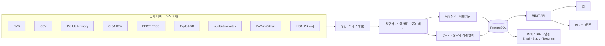

<div align="center">

# VulnIntel

**NVD · OSV · GitHub Advisory · CISA KEV · EPSS · Exploit-DB · KISA 보호나라 등 9개 공개 소스의 취약점 데이터를 웹과 API 하나로 제공합니다.**

[](https://www.vulnintelapp.com/)
[](https://www.vulnintelapp.com/ko/developers)

[](https://nextjs.org)
[](https://fastapi.tiangolo.com)
[](https://python.org)
[](https://postgresql.org)

</div>

---

## 무엇을 해결하나요

보안 취약점 정보는 여러 곳에 흩어져 있습니다. CVE 하나를 제대로 보려면 NVD에서 CVSS를 확인하고, OSV나 GitHub Advisory에서 영향받는 패키지와 수정 버전을 찾고, CISA KEV에서 실제 악용 여부를, EPSS에서 악용 가능성을 따로 봐야 합니다. 국내 권고는 KISA 보호나라에 또 따로 있고, 대부분 영문이라 팀에 공유하려면 다시 정리해야 합니다.

| 문제 | 현실 |
|------|------|
| **데이터가 흩어져 있다** | 소스마다 형식과 식별자(CVE, GHSA, OSV ID)가 달라서, 같은 취약점끼리 맞춰 보는 일부터 수작업입니다. |
| **CVSS만으로는 순서가 안 정해진다** | CVSS 9.8인데 악용 신호가 없는 것과, CVSS 7.0인데 이미 공격에 쓰이는 것. 무엇을 먼저 고쳐야 할까요? |
| **직접 만들면 유지가 일이다** | 소스별 호출 제한, 대용량 덤프, 스키마 변경, 중복 제거를 계속 따라가야 합니다. |

VulnIntel은 이 소스들을 매일 수집해 하나의 취약점 레코드로 합치고, CVSS와 악용 신호를 함께 본 우선순위(VPI)를 붙여 웹·API·CI에서 쓸 수 있게 합니다.



---

## 데이터 소스와 갱신 주기

| 소스 | 가져오는 것 | 갱신 (KST) |
|------|-------------|-----------|
| NVD | CVE 본문, CVSS v2/v3.x/v4.0, CPE 영향 제품, CWE, NVD 처리 상태 | 매일 09:00 · 21:00 |
| OSV | 8개 생태계 패키지의 영향 버전 범위와 수정 버전 | 매일 01:00 · 13:00 |
| GitHub Advisory | GHSA 권고, 패키지 영향 범위 | 매일 04:30 |
| CISA KEV | 실제 악용 등재, 등재일·조치 기한, 랜섬웨어 악용 여부, 조치 지시 | 매일 14:00 |
| FIRST EPSS | 30일 내 악용 확률과 백분위 | 매일 15:00 |
| Exploit-DB | 공개 익스플로잇(PoC) 존재 | 매일 02:30 |
| nuclei-templates | 원격 탐지 템플릿 보유 여부 | 매일 05:00 |
| PoC-in-GitHub | 공개 PoC 저장소 링크와 개수 (자동 수집, 미검증) | 매일 05:10 |
| KISA 보호나라 | 보안공지 번호·제목·날짜·원문 링크, 영향 제품 표, 공지 ↔ CVE 매핑 | 매일 09:30 · 21:30 |

수집 뒤에 도는 작업도 정해진 시각에 돕니다.

| 작업 | 시각 (KST) |
|------|-----------|
| VPI 재계산 (EPSS 갱신분은 수집과 동시에 반영) | 매일 06:00 |
| 조치 리포트 발행 / 리포트 메일 | 매일 06:30 / 07:00 |
| 구독 알림 다이제스트 | 매일 09:00 |
| 번역 (한국어 · 중국어) | 3시간마다 |

이 밖에 스캔의 **정밀 검사**를 고르면 deps.dev(Google Open Source Insights)에서 컴포넌트 라이선스, 개발 중단 여부, OpenSSF Scorecard 점수를 조회해 결과에 붙입니다.

### 데이터 규모

2026-10-16 운영 DB 기준입니다.

| 항목 | 건수 |
|------|-----:|
| 통합 취약점 (중복 제거) | 1,037,741 |
| 소스별 별칭 (GHSA·OSV ID 등) | 822,649 |
| 레퍼런스 링크 | 1,548,598 |
| NVD CPE 제품 | 371,489 |
| CVE ↔ 제품 영향 관계 | 2,335,679 |
| CWE 매핑 | 399,378 |
| 패키지 영향 범위 | 88,615 |
| CISA KEV 등재 | 1,745 |
| KISA 보안공지 | 2,562 |
| 한국어 번역 완료 | 128,167 |

---

## 핵심 기능

### 1. 통합 취약점 조회

CVE ID, GHSA·OSV ID 중 무엇으로 찾아도 같은 레코드가 나옵니다. 상세 한 건에 담기는 내용은 다음과 같습니다.

- 소스별 CVSS 점수와 벡터, 그중 대표 점수 1개와 그 출처 등급(NIST / CNA / 제3자)
- 영향 패키지(생태계·버전 범위·수정 버전)와 NVD CPE 기반 영향 제품
- CISA KEV 등재일·조치 기한·랜섬웨어 악용 여부, 조치 지시를 유형별로 분류한 값
- EPSS 확률·백분위, 공개 익스플로잇 여부, nuclei 탐지 템플릿, PoC-in-GitHub 저장소 수
- KISA 보호나라 보안공지 매핑(번호·제목·날짜·원문 링크)
- CWE, NVD 처리 상태, 이 레코드에 기여한 소스 목록
- VPI 점수·레벨과 그 계산 근거

목록 API는 심각도, KEV 등재, KISA 공지 여부, 공개 익스플로잇, 탐지 템플릿 보유, 랜섬웨어, 생태계, CVSS·VPI·EPSS 범위, VPI 레벨, 공개일, 벤더·제품으로 거르고 VPI·CVSS·EPSS·KEV 등재일 등으로 정렬할 수 있습니다.

### 2. VPI — 무엇부터 고칠지

VPI(Vulnerability Priority Index)는 CVSS(영향)와 악용 신호를 함께 본 0~100 점수입니다. 웹 화면에는 이를 행동 단위로 묶은 **VPI 레벨(L1~L6)** 만 보여주고, 점수는 API와 정렬에 씁니다. 취약점 목록·상세 응답에는 계산 근거(`vpi_breakdown`)가 함께 나갑니다.

**점수 (공식 버전 `vpi-v2`)**

```
VPI = min( 기준점(티어) + 폭(티어) × CVSS / 10 + 랜섬웨어 가산, 100 )
```

악용 신호는 더하지 않고 위에서부터 처음 맞는 티어 하나만 적용합니다. KEV·PoC·EPSS는 모두 "악용 가능성"이라는 같은 축이라, 더하면 같은 신호를 여러 번 세게 되기 때문입니다.

| 티어 | 조건 | 기준점 | 폭 | 점수 범위 |
|------|------|------:|---:|----------|
| `kev` | CISA KEV 등재 | 60 | 40 | 60–100 |
| `poc` | 공개 익스플로잇 확인 (Exploit-DB 등재 또는 Exploit 태그 레퍼런스) | 30 | 50 | 30–80 |
| `epss_high` | EPSS 백분위 상위 10% | 25 | 45 | 25–70 |
| `baseline` | 해당 신호 없음 | 0 | 65 | 0–65 |

- 랜섬웨어 가산: CISA KEV에서 랜섬웨어 악용이 확인되면 +5
- CVSS가 없으면 심각도 등급의 중앙값(CRITICAL 9.5 · HIGH 8.0 · MEDIUM 5.5 · LOW 2.0)으로, 그마저 없으면 5.5로 계산합니다. EPSS가 없다고 점수가 깎이지는 않습니다.
- 티어 값과 EPSS 기준은 백테스트 전 추정치입니다. 바꾸면 `formula_version`을 올려 구분합니다.

**레벨**

| 레벨 | 이름 | 조건 | 권장 행동 |
|------|------|------|----------|
| L6 | 최우선 | KEV 등재 + (랜섬웨어 악용 또는 CVSS 9.0 이상) | 영향 자산 최우선 조치, 침해 징후 점검 |
| L5 | 긴급 | KEV 등재 | 영향 자산 확인 후 패치·완화 우선 적용 |
| L4 | 우선 | CVSS 9.0 이상 + 공격 신호 | 이번 패치 주기에 처리 |
| L3 | 계획 | CVSS 9.0 이상 / CVSS 4.0~8.9 + 공격 신호 / 영향정보 없이 공격 신호만 | 정기 패치 일정에 포함 |
| L2 | 모니터링 | CVSS 4.0~8.9 / CVSS 4.0 미만 + 공격 신호 | 추적 |
| L1 | 낮음 | CVSS 4.0 미만 | 정기 주기에 처리 |
| — | 미평가 | 영향정보와 공격 신호가 모두 없음, 또는 NVD Rejected | 영향정보 확보 후 재평가 |

공격 신호는 공개 PoC 또는 EPSS 상위 10%이며, 둘 다 해당해도 한 단계만 올립니다. KEV에 없는 취약점은 L4가 상한입니다.

| 사례 | CVSS | 악용 신호 | VPI | 레벨 |
|------|-----:|-----------|----:|------|
| 예시 A | 9.8 | 없음 | 63.70 | L3 계획 |
| 예시 B | 7.5 | 공개 PoC | 67.50 | L3 계획 |
| 예시 C | 7.0 | CISA KEV | 88.00 | L5 긴급 |
| Log4Shell (CVE-2021-44228) | 10.0 | CISA KEV + 랜섬웨어 | 100.00 | L6 최우선 |

CVSS 7.0이라도 실제로 공격에 쓰이고 있다면 9.8짜리 무신호 취약점보다 먼저 올라옵니다.

### 3. 의존성 · SBOM 스캔과 CI 게이트

lock 파일이나 SBOM을 올리면 비동기 작업으로 처리하고, 패키지별 판정·정책 결과·SBOM을 돌려줍니다.

- **입력**: CycloneDX JSON, SPDX 2.x JSON, `package-lock.json`, `composer.lock`, NuGet `packages.lock.json`, `Cargo.lock`, `Gemfile.lock`, `go.sum`, `mvn dependency:tree` 출력, `requirements.txt`. 파일명이 아니라 내용으로 형식을 판단합니다.
- **판정 생태계**: npm · PyPI · Go · crates.io · Maven · RubyGems · NuGet · Packagist
- **판정 5상태**: `affected`(영향 있음) · `fixed`(수정됨) · `not_affected`(영향 없음) · `unknown`(확인 필요) · `unsupported`(평가 미지원). 영향 없음을 확인하지 못한 결과를 "안전"으로 표시하지 않습니다.
- **정책 게이트**: 규칙을 JSON으로 넘기면 `policy.passed`와 위반 내역을 돌려줍니다.

  | 규칙 | 의미 |
  |------|------|
  | `kev_present` | CISA KEV 등재 취약점이 있으면 |
  | `cvss_threshold` | CVSS ≥ `min_score`인 취약점이 `max_count`개를 넘으면 |
  | `severity_threshold` | 지정한 심각도의 취약점이 `max_count`개를 넘으면 |
  | `ignore_list` | 지정한 CVE·GHSA를 예외 처리 |

  각 규칙은 `fail` 또는 `warn`으로 동작합니다. 정책을 생략하면 기본값(KEV 등재 시 실패, CVSS 9.0 이상 1건 이상 실패, CVSS 7.0 이상 5건 초과 경고)이 적용됩니다.
- **VEX**: OpenVEX 또는 CycloneDX VEX 문서를 함께 올리면 `not_affected`·`fixed`로 선언된 항목을 게이트에서 빼고, 뺀 내역을 근거·작성자·시점과 함께 `policy.suppressed`에 남깁니다.
- **SBOM 출력**: 결과를 CycloneDX 1.7 SBOM으로 내려받을 수 있습니다.
- **SBOM 최소 요소 점검**: 올린 SBOM이 CISA 2026 최소 요소를 갖췄는지, 무엇이 빠졌는지 보여줍니다.
- **정밀 검사**: 컴포넌트 라이선스 분류(허용형 / 약한·강한·네트워크 카피레프트 / 기타 / 미상), 개발 중단 패키지, OpenSSF Scorecard 점수를 추가로 붙입니다.

### 4. 조치 리포트와 조치 대장

새로 CISA KEV에 등재됐거나, 이미 알려진 CVE에 공개 익스플로잇이 뒤늦게 붙은 건을 골라 매일 아침 리포트로 발행합니다. 해당 건이 없는 날은 발행하지 않습니다.

- CVE마다 한국어 요약, 영향 범위와 패치 버전, 설치 버전 확인 명령, KISA 공지 링크, CISA 조치 지시, PoC 출처를 정리합니다.
- 리포트는 XLSX 조치 대장으로 내려받거나 이메일(KST 07:00)로 받을 수 있습니다.
- 항목마다 조치 상태(미조치 · 진행 중 · 조치 완료 · 조치 안 함 · 해당 없음)와 사유를 기록해 두고, 미조치 건은 리마인더 메일로 다시 알려줍니다.

### 5. 알림

관심 대상을 구독하면 조건에 맞는 새 취약점을 매일 KST 09:00에 모아 보냅니다.

- 구독 대상: 패키지(생태계 + 이름), CVE, 벤더, CISA KEV 신규 등재
- 채널: Email · Slack(Incoming Webhook) · Telegram(Bot)
- 발송 이력은 설정 화면에서 확인할 수 있습니다.

### 6. 한국어 · 국내 정보

- 화면은 한국어 · 영어 · 중국어(간체)를 지원합니다.
- CVE 제목과 설명은 한국어·중국어로 기계 번역하며, VPI가 높은 취약점부터 순서대로 채웁니다. 번역이 아직 없는 건은 영문 원문을 보여줍니다.
- KISA 보호나라 보안공지를 CVE와 연결해 상세 화면과 대시보드에 보여줍니다. 공지 본문은 저작권이 유보돼 있어 번호·제목·날짜·원문 링크·영향 제품 표 같은 사실 정보만 다룹니다.

---

## 써보는 법

### 웹 — [www.vulnintelapp.com](https://www.vulnintelapp.com/)

| 로그인 없이 | 가입 후 (이메일 또는 Google 계정) |
|-------------|----------------------------------|
| 통합 검색, CVE 상세 | 의존성·SBOM 스캔과 스캔 이력 |
| 대시보드 (신규 CVE 추이, KEV·KISA 최근 등재, 고위험 CVE, 영향 패키지 상위) | 조치 리포트, 조치 대장 |
| 벤더·제품 카탈로그, VPI 랭킹 | 알림 구독과 채널 설정 |
| 보안 블로그, 개발자 포털 | API 키 발급 (계정당 3개) |

PoC-in-GitHub 저장소 링크는 로그인한 사용자에게만 보여주고, 로그인하지 않으면 개수만 보여줍니다.

현재 가입과 이용에 요금이 없습니다. 유료 플랜은 준비 중이며, 확정되면 웹사이트에서 안내합니다.

### API

- 기본 URL: `https://api.vulnintelapp.com/api/v1`
- 문서: [개발자 포털](https://www.vulnintelapp.com/ko/developers) (공개 스펙: `https://api.vulnintelapp.com/api/v1/public-openapi.json`)
- 조회 API는 인증 없이 호출할 수 있습니다. 스캔 API는 `X-Api-Key` 헤더(웹에서 발급) 또는 로그인 세션이 필요합니다.

| 메서드 · 경로 | 인증 | 내용 |
|---------------|------|------|
| `GET /vulnerabilities` | 없음 | 목록 · 필터 · 정렬 |
| `GET /vulnerabilities/{id}` | 없음 | CVE·GHSA·OSV ID로 통합 상세 (`lang=ko\|en\|zh`) |
| `GET /vulnerabilities/{id}/packages` | 없음 | 영향 패키지와 수정 버전 |
| `GET /vulnerabilities/{id}/products` | 없음 | NVD CPE 기반 영향 제품 |
| `GET /packages` | 없음 | 패키지 하나를 버전 기준으로 판정 |
| `POST /scan` | API 키 | 패키지 최대 100개 일괄 판정 (동기) |
| `POST /scan/jobs` | API 키 | lock 파일 · SBOM 업로드 스캔 (비동기, 202) |
| `GET /scan/jobs/{job_id}` | API 키 | 진행률과 결과 |
| `GET /scan/jobs/{job_id}/sbom` | API 키 | CycloneDX 1.7 SBOM |
| `GET /stats` | 없음 | 집계 통계 |
| `GET /attribution` | 없음 | 데이터 출처와 라이선스 |

```bash
# CVE 통합 상세
curl "https://api.vulnintelapp.com/api/v1/vulnerabilities/CVE-2021-44228?lang=ko"

# 패키지 버전 판정 — version을 주면 5상태로 판정
curl "https://api.vulnintelapp.com/api/v1/packages?ecosystem=npm&name=lodash&version=4.17.19"

# KEV 등재 + VPI 레벨 5 이상, 최근 공개순
curl "https://api.vulnintelapp.com/api/v1/vulnerabilities?is_kev=true&vpi_level_min=5&sort=published_at&order=desc"
```

상세 응답 일부 (실제 응답에는 별칭·소스별 점수·CWE·레퍼런스·EPSS 등이 더 있습니다):

```jsonc
{
  "success": true,
  "data": {
    "cve_id": "CVE-2021-44228",
    "severity": "CRITICAL",
    "cvss_score": "10.0",
    "vpi": "100.00",
    "vpi_level": 6,
    "vpi_breakdown": {
      "impact_score": "100.00",
      "impact_source": "cvss",
      "exploitation_tier": "kev",
      "tier_base": "60.00",
      "severity_component": "40.00",
      "ransomware_bonus": "5.00",
      "formula_version": "vpi-v2",
      "level": 6,
      "level_factors": [
        { "code": "kev", "effect": "applied" },
        { "code": "ransomware", "effect": "applied" },
        { "code": "cvss_critical", "effect": "applied" }
        // …
      ]
    },
    "is_kev": true,
    "known_ransomware": true,
    "kev": { "date_added": "2021-12-10", "due_date": "2021-12-24", "known_ransomware": true /* … */ },
    "poc_signals": { /* nuclei, github_poc — 비로그인이면 github_poc.top은 null */ }
    // …
  }
}
```

점수류 숫자 필드(`cvss_score`, `vpi`, EPSS 등)는 문자열로 나갑니다.

### CI 파이프라인

API 키 하나로 빌드에 보안 게이트를 걸 수 있습니다.

```bash
API=https://api.vulnintelapp.com/api/v1
AUTH="X-Api-Key: $VULNINTEL_API_KEY"

# 1) 업로드 → 202 + job_id
JOB=$(curl -sf -X POST "$API/scan/jobs" -H "$AUTH" \
  -F file=@package-lock.json \
  -F kind=lockfile \
  -F 'policy={"rules":[{"type":"kev_present","action":"fail"},{"type":"cvss_threshold","action":"fail","min_score":9.0}]}' \
  | jq -r .job_id)

# 2) 끝날 때까지 대기
while :; do
  RES=$(curl -sf "$API/scan/jobs/$JOB" -H "$AUTH")
  STATUS=$(echo "$RES" | jq -r .status)
  [ "$STATUS" = completed ] || [ "$STATUS" = failed ] && break
  sleep 5
done

# 3) 결과 출력 후, 정책을 통과하지 못하면 빌드 실패
echo "$RES" | jq '.result.summary, .result.policy.violations'
echo "$RES" | jq -e '.result.policy.passed == true' > /dev/null
```

`result.summary.unknown_vulnerabilities`가 0보다 크거나 `warnings`에 미지원 생태계가 있으면 판정하지 못한 항목이 있다는 뜻입니다. 이 경우는 통과로 처리하지 않는 것을 권장합니다. VEX 문서는 `-F vex=@openvex.json`, 정밀 검사는 `-F scan_depth=precise`로 함께 보낼 수 있습니다.

---

## 지원 범위와 한계

- **언어 패키지만 판정합니다.** Linux 배포판 패키지(deb·rpm·apk), 컨테이너 이미지 직접 스캔, Windows·macOS는 아직 지원하지 않습니다. 이런 컴포넌트가 든 SBOM을 올리면 그 항목은 `unsupported`로 따로 표시합니다. 미지원은 안전하다는 뜻이 아닙니다.
- **같은 입력은 24시간 동안 결과를 재사용합니다.** 같은 파일과 같은 정책으로 24시간 안에 다시 스캔하면 이전 결과를 돌려주므로, 그 사이 새로 등재된 KEV가 바로 반영되지 않을 수 있습니다.
- **번역은 기계 번역입니다.** 전체 취약점이 아니라 일부(2026-10-16 기준 한국어 128,167건)가 번역돼 있고, 우선순위가 높은 것부터 채워집니다.
- **PoC 링크는 검증하지 않습니다.** PoC-in-GitHub는 자동 수집된 목록이라 악성 코드가 섞여 있을 수 있습니다. 응답에도 `verified: false`로 표시합니다.
- **VPI는 판단 보조 지표입니다.** 자산의 노출 범위, 설정, 보완 통제 같은 환경 정보는 반영하지 않습니다.

---

## 보안과 개인정보

- 로그인 세션은 HTTP-only 쿠키로 관리하고, 웹은 요청마다 nonce를 쓰는 CSP를 적용합니다.
- 알림 채널 비밀값(Slack Webhook URL, Telegram 봇 토큰)은 AES-256-GCM으로 암호화해 저장하고, 화면에는 가려서 보여줍니다.
- API 키는 발급 직후 한 번만 보여줍니다.
- 기본 스캔은 외부로 아무것도 보내지 않습니다. 정밀 검사를 고른 경우에만 컴포넌트 이름과 버전을 deps.dev에 조회합니다.

---

## 기술 구성

| 영역 | 구성 |
|------|------|
| 웹 | Next.js 15 (App Router) · React 19 · TypeScript · Tailwind CSS 4 · shadcn/ui · TanStack Query · next-intl, Vercel 배포 |
| API | Python 3.12 · FastAPI · SQLAlchemy 2 (async) · Alembic · dependency-injector |
| 수집 · 작업 | Celery + Celery Beat — 수집, 번역, VPI 재계산, 리포트, 알림을 용도별 큐로 분리 |
| 데이터 | PostgreSQL 17, Redis 7 (캐시 · 작업 브로커 · 세션) |
| 운영 | Linux 서버 + Nginx + systemd |

백엔드는 도메인별로 router → service → repository 계층을 나눴고, VPI 계산은 Python 구현과 대량 갱신용 SQL 구현이 같은 값을 내는지 테스트로 고정해 두었습니다.

---

## 로드맵

일정은 확정되지 않았습니다.

- **GitHub Action**: 위 CI 절차를 Action 하나로 쓸 수 있게 공개 준비 중
- **Linux 배포판 패키지 판정**: 배포판 보안 패치(백포트)를 반영한 deb·rpm·apk 판정 준비 중
- **유료 플랜**: 판정량에 따른 플랜 준비 중

---

## 데이터 출처와 라이선스

VulnIntel 서비스와 소스 코드는 오픈소스가 아니며, 이 저장소에는 소개 문서만 있습니다. VulnIntel이 수집해 제공하는 데이터에는 각 원본 소스의 라이선스와 이용 조건이 따로 적용됩니다.

| 소스 | 라이선스 · 이용 조건 | 비고 |
|------|---------------------|------|
| [NVD](https://nvd.nist.gov) (NIST) | Public Domain (미국 정부 저작물) / [NVD API 이용약관](https://nvd.nist.gov/developers/terms-of-use) | |
| [OSV](https://osv.dev) | 원천 소스별 상이 (CC BY 4.0, CC0 1.0 등) | |
| [GitHub Advisory Database](https://github.com/github/advisory-database) | CC BY 4.0 | |
| [CISA KEV](https://www.cisa.gov/known-exploited-vulnerabilities-catalog) | Public Domain (미국 정부 저작물) | |
| [EPSS](https://www.first.org/epss/) (FIRST.org) | FIRST EPSS 이용 조건 | |
| [Exploit-DB](https://www.exploit-db.com) (OffSec) | GPL-2.0 | |
| [nuclei-templates](https://github.com/projectdiscovery/nuclei-templates) (ProjectDiscovery) | MIT — Copyright (c) 2025 ProjectDiscovery, Inc. | 템플릿 존재·경로만 사용, 본문 미수집 |
| [PoC-in-GitHub](https://github.com/nomi-sec/PoC-in-GitHub) (nomi-sec) | CC0 1.0 | 저장소 링크·개수·스타 수만 사용, 미검증 |
| [KISA 보호나라 보안공지](https://www.boho.or.kr/kr/bbs/list.do?menuNo=205020&bbsId=B0000133) (한국인터넷진흥원) | 라이선스 미명시, 출처 표시 | 번호·제목·날짜·원문 링크·영향 제품 표 등 사실만 제공 |
| [CVE Program](https://www.cve.org) (MITRE) | [CVE Program 이용약관](https://www.cve.org/Legal/TermsOfUse) | |
| [WPVulnerability](https://www.wpvulnerability.com) | EUPL-1.2 | 현재 수집 중단 |
| [deps.dev](https://deps.dev) (Google Open Source Insights) | CC BY 4.0 | 정밀 검사의 라이선스·개발 중단 정보 |
| [OpenSSF Scorecard](https://scorecard.dev) (deps.dev 경유) | CDLA-Permissive-2.0 | 정밀 검사의 Scorecard 점수 |

- This product uses the NVD API but is not endorsed or certified by the NVD.
- CVE is a registered trademark of The MITRE Corporation.
- EPSS scores by FIRST.org — https://www.first.org/epss
- VulnIntel은 원천 데이터를 정규화·중복 제거·재점수화해 제공합니다(Modifications have been made). 라이선스 분류 같은 파생값은 VulnIntel이 만든 값이며 원본 소스에 귀속되지 않습니다.

API의 모든 응답 헤더 `X-Data-Attribution`에 출처 요약이 들어가고, 전체 목록은 `GET /api/v1/attribution`과 웹의 [데이터 라이선스](https://www.vulnintelapp.com/ko/data-license) 페이지에서 볼 수 있습니다. 데이터를 다시 배포할 때는 원본 출처를 표기해 주세요.

---

## 문의

도입·연동 문의: [웹사이트 문의 양식](https://www.vulnintelapp.com/ko/pilot?type=enterprise)
