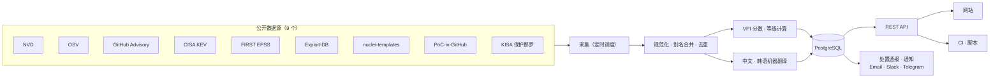

<div align="center">

# VulnIntel

[English](README.md) · [한국어](README.ko.md) · **简体中文**

**汇集 NVD · OSV · GitHub Advisory · CISA KEV · EPSS · Exploit-DB 等 9 个公开来源的漏洞数据，通过同一个网站和 API 提供。界面支持简体中文，CVE 标题和描述按优先级机器翻译为中文。**

[](https://www.vulnintelapp.com/)
[](https://www.vulnintelapp.com/zh/developers)

[](https://nextjs.org)
[](https://fastapi.tiangolo.com)
[](https://python.org)
[](https://postgresql.org)

</div>

---

## 解决什么问题

漏洞信息分散在多个来源。要把一个 CVE 看完整，得先去 NVD 查 CVSS，再到 OSV 或 GitHub Advisory 找受影响的软件包和修复版本，然后分别去 CISA KEV 看是否已被实际利用、去 EPSS 看被利用的可能性。这些来源基本都是英文，团队内部流转前往往还要先读原文、再整理成中文。

| 问题 | 现状 |
|------|------|
| **数据分散** | 各来源的格式和标识符（CVE、GHSA、OSV ID）各不相同，光是把同一个漏洞对应起来就得手工完成。 |
| **原文以英文为主** | NVD、GitHub Advisory、CISA KEV 的描述都是英文，逐条阅读、转述都要花时间。 |
| **仅凭 CVSS 排不出先后** | CVSS 9.8 但没有利用信号的漏洞，和 CVSS 7.0 但已被用于攻击的漏洞，应该先修哪个？ |
| **自建要长期维护** | 需要持续跟进各来源的调用频率限制、大体量数据转储、Schema 变更和去重。 |

VulnIntel 每天采集这些来源，合并成一条漏洞记录，附上综合考虑 CVSS 与利用信号的优先级（VPI），并把 CVE 标题和描述机器翻译为中文，可在网站、API 和 CI 中使用。

对中文用户来说，可以直接用上的是这几项：

- 网站界面可切换为简体中文。API 详情接口传 `lang=zh` 返回中文标题和描述，尚未翻译的条目返回英文原文。
- CVE 标题和描述按 VPI 从高到低机器翻译为中文，截至 2026-10-16 已完成 73,304 条，每 3 小时继续补充。
- NVD、OSV、GitHub Advisory、CISA KEV、EPSS 等国际来源合并为一条记录，用 CVE、GHSA 或 OSV ID 都能查到。
- VPI 等级（L1~L6）把 KEV 收录、公开 PoC、EPSS 和 CVSS 放在一起，给出处置的先后顺序。
- 上传 lock 文件或 SBOM，按策略返回通过或失败，可作为 CI 门禁。



---

## 数据源与更新周期

下表时间均为韩国标准时间（KST，UTC+9），比北京时间早 1 小时，例如 KST 09:00 即北京时间 08:00。

| 来源 | 采集内容 | 更新（KST） |
|------|-------------|-----------|
| NVD | CVE 正文、CVSS v2/v3.x/v4.0、CPE 受影响产品、CWE、NVD 处理状态 | 每天 09:00 · 21:00 |
| OSV | 8 个生态系统软件包的受影响版本范围与修复版本 | 每天 01:00 · 13:00 |
| GitHub Advisory | GHSA 公告、软件包影响范围 | 每天 04:30 |
| CISA KEV | 实际利用收录、收录日期·修复期限、是否被勒索软件利用、处置指示 | 每天 14:00 |
| FIRST EPSS | 30 天内被利用的概率与百分位 | 每天 15:00 |
| Exploit-DB | 是否存在公开漏洞利用（PoC） | 每天 02:30 |
| nuclei-templates | 是否有远程检测模板 | 每天 05:00 |
| PoC-in-GitHub | 公开 PoC 仓库链接与数量（自动采集，未经验证） | 每天 05:10 |
| KISA 保护那罗（韩国） | 安全公告编号·标题·日期·原文链接、受影响产品表、公告 ↔ CVE 映射 | 每天 09:30 · 21:30 |

采集之后的后续任务也按固定时间运行。

| 任务 | 时间（KST） |
|------|-----------|
| VPI 重新计算（EPSS 更新部分在采集时同步反映） | 每天 06:00 |
| 处置通报发布 / 通报邮件 | 每天 06:30 / 07:00 |
| 订阅通知每日摘要 | 每天 09:00 |
| 翻译（中文 · 韩语） | 每 3 小时 |

此外，扫描时选择精确检测，会从 deps.dev（Google Open Source Insights）查询组件许可证、是否停止维护以及 OpenSSF Scorecard 分数，并附加到结果中。

### 数据规模

数据截至 2026-10-16（生产数据库）。

| 项目 | 数量 |
|------|-----:|
| 统一漏洞（去重后） | 1,037,741 |
| 各来源别名（GHSA·OSV ID 等） | 822,649 |
| 参考链接 | 1,548,598 |
| NVD CPE 产品 | 371,489 |
| CVE ↔ 产品影响关系 | 2,335,679 |
| CWE 映射 | 399,378 |
| 软件包影响范围 | 88,615 |
| CISA KEV 收录 | 1,745 |
| 中文翻译已完成 | 73,304 |
| 韩语翻译已完成 | 128,167 |
| KISA 安全公告（韩国） | 2,562 |

---

## 核心功能

### 1. 统一漏洞查询

无论用 CVE ID 还是 GHSA·OSV ID 查询，得到的都是同一条记录。单条详情包含以下内容：

- 各来源的 CVSS 分数与向量，以及其中 1 个代表分数及其来源等级（NIST / CNA / 第三方）
- 受影响软件包（生态系统·版本范围·修复版本）及基于 NVD CPE 的受影响产品
- CISA KEV 收录日期·修复期限·是否被勒索软件利用，以及按类型分类的处置指示
- EPSS 概率·百分位、是否有公开漏洞利用、nuclei 检测模板、PoC-in-GitHub 仓库数
- CWE、NVD 处理状态、为该记录提供数据的来源列表
- VPI 分数·等级及其计算依据
- KISA 保护那罗（韩国）安全公告映射（编号·标题·日期·原文链接）

列表 API 可按严重程度、是否收录于 KEV、是否有 KISA 公告、公开漏洞利用、是否有检测模板、勒索软件、生态系统、CVSS·VPI·EPSS 范围、VPI 等级、发布日期、厂商·产品进行筛选，并可按 VPI·CVSS·EPSS·KEV 收录日期等排序。

### 2. VPI — 先修哪个

VPI（Vulnerability Priority Index）是综合 CVSS（影响）与利用信号得出的 0~100 分数。网页上只显示按处置行动划分的 **VPI 等级（L1~L6）**，分数则用于 API 和排序。漏洞列表和详情响应会一并返回计算依据（`vpi_breakdown`）。

**分数（公式版本 `vpi-v2`）**

```
VPI = min( 基准分(档位) + 幅度(档位) × CVSS / 10 + 勒索软件加分, 100 )
```

利用信号不做叠加，从上往下只取第一个命中的档位。KEV、PoC、EPSS 衡量的都是“被利用的可能性”这同一个维度，叠加就会把同一信号重复计算。

| 档位 | 条件 | 基准分 | 幅度 | 分数范围 |
|------|------|------:|---:|----------|
| `kev` | 已收录于 CISA KEV | 60 | 40 | 60–100 |
| `poc` | 已确认公开漏洞利用（收录于 Exploit-DB 或有 Exploit 标签的参考链接） | 30 | 50 | 30–80 |
| `epss_high` | EPSS 百分位前 10% | 25 | 45 | 25–70 |
| `baseline` | 无上述信号 | 0 | 65 | 0–65 |

- 勒索软件加分：在 CISA KEV 中确认被勒索软件利用时 +5
- 没有 CVSS 时，按严重程度等级的中间值（CRITICAL 9.5 · HIGH 8.0 · MEDIUM 5.5 · LOW 2.0）计算；连严重程度也没有则按 5.5 计算。缺少 EPSS 不会扣分。
- 档位数值和 EPSS 阈值是回测前的估计值。如有调整，会提升 `formula_version` 加以区分。

**等级**

| 等级 | 名称 | 条件 | 建议行动 |
|------|------|------|----------|
| L6 | 最优先 | 已收录于 KEV +（被勒索软件利用或 CVSS 9.0 及以上） | 最优先处置受影响资产，并排查入侵迹象 |
| L5 | 紧急 | 已收录于 KEV | 确认受影响资产后，优先打补丁或缓解 |
| L4 | 优先 | CVSS 9.0 及以上 + 攻击信号 | 在本次补丁周期内处理 |
| L3 | 计划 | CVSS 9.0 及以上 / CVSS 4.0~8.9 + 攻击信号 / 无影响信息、仅有攻击信号 | 纳入常规补丁计划 |
| L2 | 监控 | CVSS 4.0~8.9 / CVSS 低于 4.0 + 攻击信号 | 持续跟踪 |
| L1 | 较低 | CVSS 低于 4.0 | 按常规周期处理 |
| — | 未评级 | 既无影响信息也无攻击信号，或 NVD Rejected | 获取影响信息后重新评估 |

攻击信号指公开 PoC 或 EPSS 前 10%，两者同时满足也只上调一级。未被 KEV 收录的漏洞最高为 L4。

| 案例 | CVSS | 利用信号 | VPI | 等级 |
|------|-----:|-----------|----:|------|
| 示例 A | 9.8 | 无 | 63.70 | L3 计划 |
| 示例 B | 7.5 | 公开 PoC | 67.50 | L3 计划 |
| 示例 C | 7.0 | CISA KEV | 88.00 | L5 紧急 |
| Log4Shell (CVE-2021-44228) | 10.0 | CISA KEV + 勒索软件 | 100.00 | L6 最优先 |

即使 CVSS 只有 7.0，只要正被用于实际攻击，就会排在 CVSS 9.8 但没有信号的漏洞前面。

### 3. 依赖 · SBOM 扫描与 CI 门禁

上传 lock 文件或 SBOM 后，系统以异步任务处理，并返回各软件包的判定结果、策略结果和 SBOM。

- **输入**：CycloneDX JSON、SPDX 2.x JSON、`package-lock.json`、`composer.lock`、NuGet `packages.lock.json`、`Cargo.lock`、`Gemfile.lock`、`go.sum`、`mvn dependency:tree` 输出、`requirements.txt`。根据文件内容而不是文件名判断格式。
- **判定生态系统**：npm · PyPI · Go · crates.io · Maven · RubyGems · NuGet · Packagist
- **判定 5 种状态**：`affected`（受影响）· `fixed`（已修复）· `not_affected`（不受影响）· `unknown`（需确认）· `unsupported`（暂不支持评估）。未能确认“不受影响”的结果，不会显示为“安全”。
- **策略门禁**：以 JSON 传入规则，返回 `policy.passed` 与违规明细。

  | 规则 | 含义 |
  |------|------|
  | `kev_present` | 存在已收录于 CISA KEV 的漏洞时 |
  | `cvss_threshold` | CVSS ≥ `min_score` 的漏洞超过 `max_count` 个时 |
  | `severity_threshold` | 指定严重程度的漏洞超过 `max_count` 个时 |
  | `ignore_list` | 将指定的 CVE·GHSA 列为例外 |

  每条规则以 `fail` 或 `warn` 方式生效。省略策略时适用默认值（收录于 KEV 即失败，CVSS 9.0 及以上有 1 个即失败，CVSS 7.0 及以上超过 5 个则警告）。
- **VEX**：同时上传 OpenVEX 或 CycloneDX VEX 文档，声明为 `not_affected`·`fixed` 的项会从门禁中排除，排除明细连同理由·作者·时间一起记录在 `policy.suppressed` 中。
- **SBOM 输出**：可将结果下载为 CycloneDX 1.7 SBOM。
- **SBOM 最低要素检查**：显示上传的 SBOM 是否满足 CISA 2026 最低要素，以及缺了哪些。
- **精确检测**：额外附加组件许可证分类（宽松型 / 弱·强·网络 Copyleft / 其他 / 未知）、已停止维护的软件包、OpenSSF Scorecard 分数。

### 4. 处置通报与处置台账

每天早上挑出新收录于 CISA KEV 的漏洞，以及已知 CVE 后来才出现公开漏洞利用的情况，发布为通报。没有符合条件的漏洞时当天不发布。

- 每个 CVE 都整理了摘要（目前仅有韩语版）、影响范围与补丁版本、已安装版本的确认命令、CISA 处置指示、PoC 来源，以及 KISA 公告链接（如有）。
- 通报可下载为 XLSX 处置台账，也可通过邮件（KST 07:00，即北京时间 06:00）接收。
- 可为每一项记录处置状态（未处置 · 处置中 · 处置完成 · 不予处置 · 不适用）及原因；未处置的项会通过提醒邮件再次通知。

### 5. 通知

订阅关注对象后，每天 KST 09:00（北京时间 08:00）汇总发送符合条件的新漏洞。

- 订阅对象：软件包（生态系统 + 名称）、CVE、厂商、CISA KEV 新收录
- 渠道：Email · Slack（Incoming Webhook）· Telegram（Bot）
- 发送记录可在设置页面查看。

### 6. 中文支持与 KISA 公告

- 界面支持简体中文 · 英语 · 韩语。
- CVE 标题和描述会机器翻译为中文和韩语，按 VPI 从高到低依次填充。截至 2026-10-16，中文已完成 73,304 条。尚未翻译的条目显示英文原文。
- 面向在韩开展业务或服务韩国客户的团队：KISA 保护那罗（韩国互联网振兴院）的安全公告会与 CVE 关联，在详情页和仪表盘中展示。公告正文保留版权，因此只处理编号·标题·日期·原文链接·受影响产品表等事实信息。

---

## 如何使用

### 网站 — [www.vulnintelapp.com](https://www.vulnintelapp.com/)

| 无需登录 | 注册后（邮箱或 Google 账户） |
|-------------|----------------------------------|
| 统一搜索、CVE 详情 | 依赖·SBOM 扫描与扫描历史 |
| 仪表盘（新增 CVE 趋势、KEV·KISA 最新收录、高危 CVE、受影响软件包 Top） | 处置通报、处置台账 |
| 厂商·产品目录、CVSS 盲区排行 | 通知订阅与渠道设置 |
| 安全博客、开发者门户 | 获取 API 密钥（每个账户 3 个） |

PoC-in-GitHub 仓库链接仅对已登录用户显示，未登录时只显示数量。

目前注册和使用均免费。付费方案正在准备中，确定后会在网站上公布。

### API

- 基础 URL：`https://api.vulnintelapp.com/api/v1`
- 文档：[开发者门户](https://www.vulnintelapp.com/zh/developers)（公开规范：`https://api.vulnintelapp.com/api/v1/public-openapi.json`）
- 查询类 API 无需认证即可调用。扫描 API 需要 `X-Api-Key` 请求头（在网站上获取）或登录会话。

| 方法 · 路径 | 认证 | 说明 |
|---------------|------|------|
| `GET /vulnerabilities` | 无 | 列表 · 筛选 · 排序 |
| `GET /vulnerabilities/{id}` | 无 | 按 CVE·GHSA·OSV ID 获取统一详情（`lang=ko\|en\|zh`） |
| `GET /vulnerabilities/{id}/packages` | 无 | 受影响软件包与修复版本 |
| `GET /vulnerabilities/{id}/products` | 无 | 基于 NVD CPE 的受影响产品 |
| `GET /packages` | 无 | 按版本判定单个软件包 |
| `POST /scan` | API 密钥 | 批量判定最多 100 个软件包（同步） |
| `POST /scan/jobs` | API 密钥 | 上传 lock 文件 · SBOM 扫描（异步，202） |
| `GET /scan/jobs/{job_id}` | API 密钥 | 进度与结果 |
| `GET /scan/jobs/{job_id}/sbom` | API 密钥 | CycloneDX 1.7 SBOM |
| `GET /stats` | 无 | 汇总统计 |
| `GET /attribution` | 无 | 数据来源与许可 |

```bash
# CVE 统一详情
curl "https://api.vulnintelapp.com/api/v1/vulnerabilities/CVE-2021-44228?lang=zh"

# 软件包版本判定 — 传入 version 时按 5 种状态判定
curl "https://api.vulnintelapp.com/api/v1/packages?ecosystem=npm&name=lodash&version=4.17.19"

# 已收录于 KEV + VPI 等级 5 及以上，按发布时间倒序
curl "https://api.vulnintelapp.com/api/v1/vulnerabilities?is_kev=true&vpi_level_min=5&sort=published_at&order=desc"
```

详情响应节选（实际响应还包含别名、各来源评分、CWE、参考链接、EPSS 等）：

```jsonc
{
  "success": true,
  "data": {
    "cve_id": "CVE-2021-44228",
    "severity": "CRITICAL",
    "cvss_score": "10.0",
    "vpi": "100.00",
    "vpi_level": 6,
    "vpi_breakdown": {
      "impact_score": "100.00",
      "impact_source": "cvss",
      "exploitation_tier": "kev",
      "tier_base": "60.00",
      "severity_component": "40.00",
      "ransomware_bonus": "5.00",
      "formula_version": "vpi-v2",
      "level": 6,
      "level_factors": [
        { "code": "kev", "effect": "applied" },
        { "code": "ransomware", "effect": "applied" },
        { "code": "cvss_critical", "effect": "applied" }
        // …
      ]
    },
    "is_kev": true,
    "known_ransomware": true,
    "kev": { "date_added": "2021-12-10", "due_date": "2021-12-24", "known_ransomware": true /* … */ },
    "poc_signals": { /* nuclei, github_poc — 未登录时 github_poc.top 为 null */ }
    // …
  }
}
```

评分类数值字段（`cvss_score`、`vpi`、EPSS 等）以字符串形式返回。

### CI 流水线

只需一个 API 密钥，即可在构建中加入安全门禁。

```bash
API=https://api.vulnintelapp.com/api/v1
AUTH="X-Api-Key: $VULNINTEL_API_KEY"

# 1) 上传 → 202 + job_id
JOB=$(curl -sf -X POST "$API/scan/jobs" -H "$AUTH" \
  -F file=@package-lock.json \
  -F kind=lockfile \
  -F 'policy={"rules":[{"type":"kev_present","action":"fail"},{"type":"cvss_threshold","action":"fail","min_score":9.0}]}' \
  | jq -r .job_id)

# 2) 等待扫描结束
while :; do
  RES=$(curl -sf "$API/scan/jobs/$JOB" -H "$AUTH")
  STATUS=$(echo "$RES" | jq -r .status)
  [ "$STATUS" = completed ] || [ "$STATUS" = failed ] && break
  sleep 5
done

# 3) 输出结果；未通过策略则构建失败
echo "$RES" | jq '.result.summary, .result.policy.violations'
echo "$RES" | jq -e '.result.policy.passed == true' > /dev/null
```

如果 `result.summary.unknown_vulnerabilities` 大于 0，或 `warnings` 中出现不支持的生态系统，说明存在未能判定的项，建议不要按通过处理。VEX 文档可通过 `-F vex=@openvex.json`、精确检测可通过 `-F scan_depth=precise` 一并提交。

---

## 支持范围与限制

- **仅判定编程语言生态的软件包。** 暂不支持 Linux 发行版软件包（deb·rpm·apk）、容器镜像直接扫描以及 Windows·macOS。上传包含此类组件的 SBOM 时，这些项会单独标记为 `unsupported`。不支持不代表安全。
- **不含 CNVD、CNNVD 数据。** 数据源仅为上文所列 9 个公开来源，未采集 CNVD、CNNVD 等中国漏洞库，也不提供这些库的编号映射。
- **相同输入的结果会复用 24 小时。** 24 小时内用同一文件和同一策略再次扫描时会返回之前的结果，因此期间新收录的 KEV 可能不会立即反映。
- **翻译为机器翻译。** 并非全部漏洞都有翻译。截至 2026-10-16，中文已翻译 73,304 条（韩语 128,167 条），按优先级从高到低填充。术语有疑问时请以英文原文为准。
- **PoC 链接未经验证。** PoC-in-GitHub 是自动采集的列表，可能混有恶意代码。响应中也会标记为 `verified: false`。
- **VPI 是辅助判断的指标。** 不反映资产暴露范围、配置、补偿性控制等环境信息。

---

## 安全与隐私

- 登录会话通过 HTTP-only Cookie 管理，网站对每个请求使用基于 nonce 的 CSP。
- 通知渠道的密钥（Slack Webhook URL、Telegram 机器人令牌）以 AES-256-GCM 加密存储，并在页面上遮蔽显示。
- API 密钥仅在创建后显示一次。
- 基础检测不会向外部发送任何数据。只有选择精确检测时，才会将组件名称和版本发送到 deps.dev 查询。

---

## 技术架构

| 领域 | 组成 |
|------|------|
| 网站 | Next.js 15 (App Router) · React 19 · TypeScript · Tailwind CSS 4 · shadcn/ui · TanStack Query · next-intl，部署于 Vercel |
| API | Python 3.12 · FastAPI · SQLAlchemy 2 (async) · Alembic · dependency-injector |
| 采集 · 任务 | Celery + Celery Beat — 采集、翻译、VPI 重新计算、通报、通知按用途拆分到不同队列 |
| 数据 | PostgreSQL 17、Redis 7（缓存 · 任务 Broker · 会话） |
| 运维 | Linux 服务器 + Nginx + systemd |

后端按领域划分 router → service → repository 分层。VPI 计算有 Python 实现和用于批量更新的 SQL 实现，两者结果一致由测试保证。

---

## 路线图

时间表尚未确定。

- **GitHub Action**：正在准备公开，可用一个 Action 完成上述 CI 流程
- **Linux 发行版软件包判定**：正在准备考虑发行版安全补丁（backport）的 deb·rpm·apk 判定
- **付费方案**：正在准备按判定量计费的方案

---

## 数据来源与许可

VulnIntel 服务和源代码并非开源，本仓库只包含介绍文档。VulnIntel 采集并提供的数据，分别适用各原始来源的许可协议和使用条件。

| 来源 | 许可协议 · 使用条件 | 备注 |
|------|---------------------|------|
| [NVD](https://nvd.nist.gov) (NIST) | Public Domain（美国政府作品）/ [NVD API 使用条款](https://nvd.nist.gov/developers/terms-of-use) | |
| [OSV](https://osv.dev) | 因原始来源而异（CC BY 4.0、CC0 1.0 等） | |
| [GitHub Advisory Database](https://github.com/github/advisory-database) | CC BY 4.0 | |
| [CISA KEV](https://www.cisa.gov/known-exploited-vulnerabilities-catalog) | Public Domain（美国政府作品） | |
| [EPSS](https://www.first.org/epss/) (FIRST.org) | FIRST EPSS 使用条件 | |
| [Exploit-DB](https://www.exploit-db.com) (OffSec) | GPL-2.0 | |
| [nuclei-templates](https://github.com/projectdiscovery/nuclei-templates) (ProjectDiscovery) | MIT — Copyright (c) 2025 ProjectDiscovery, Inc. | 仅使用模板是否存在及路径，不采集正文 |
| [PoC-in-GitHub](https://github.com/nomi-sec/PoC-in-GitHub) (nomi-sec) | CC0 1.0 | 仅使用仓库链接、数量和 Star 数，未经验证 |
| [KISA 保护那罗安全公告](https://www.boho.or.kr/kr/bbs/list.do?menuNo=205020&bbsId=B0000133)（韩国互联网振兴院） | 未明确许可协议，标注来源 | 仅提供编号·标题·日期·原文链接·受影响产品表等事实信息 |
| [CVE Program](https://www.cve.org) (MITRE) | [CVE Program 使用条款](https://www.cve.org/Legal/TermsOfUse) | |
| [WPVulnerability](https://www.wpvulnerability.com) | EUPL-1.2 | 目前已暂停采集 |
| [deps.dev](https://deps.dev) (Google Open Source Insights) | CC BY 4.0 | 精确检测中的许可证·停止维护信息 |
| [OpenSSF Scorecard](https://scorecard.dev)（经由 deps.dev） | CDLA-Permissive-2.0 | 精确检测中的 Scorecard 分数 |

- This product uses the NVD API but is not endorsed or certified by the NVD.
- CVE is a registered trademark of The MITRE Corporation.
- EPSS scores by FIRST.org — https://www.first.org/epss
- VulnIntel 对原始数据进行规范化、去重和重新评分后提供（Modifications have been made）。许可证分类等派生值由 VulnIntel 生成，不归属于原始来源。

API 的所有响应都会在 `X-Data-Attribution` 响应头中附带来源摘要；完整列表可通过 `GET /api/v1/attribution` 和网站的[数据许可](https://www.vulnintelapp.com/zh/data-license)页面查看。再次分发数据时，请注明原始来源。

---

## 联系我们

企业接入与集成咨询：[网站咨询表单](https://www.vulnintelapp.com/zh/pilot?type=enterprise)
